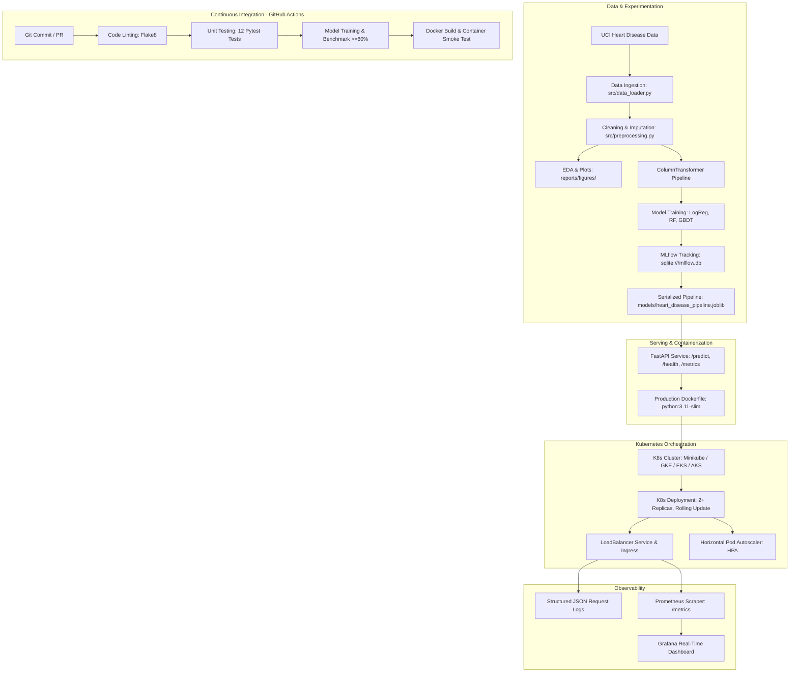

# End-to-End MLOps Pipeline: Heart Disease Risk Prediction

[](https://github.com/placeholder-org/heart-disease-mlops/actions)
[](https://www.python.org/downloads/)
[](https://fastapi.tiangolo.com)
[](https://www.docker.com/)
[](https://kubernetes.io/)
[](https://opensource.org/licenses/MIT)

**Institution:** Birla Institute of Technology and Science, Pilani (BITS Pilani)  
**Programme:** Work Integrated Learning Programmes (WILP)  
**Course:** AIMLCZG523 - Machine Learning Operations (MLOps)  
**Assignment:** Assignment 01 (50 Marks)  
**Dataset:** UCI Machine Learning Repository — Heart Disease Dataset (Cleveland Foundation)

---

## Architecture Diagram



---

## Assignment Tasks & Marks Compliance Matrix

| Task # | Assignment Component | Marks | Implementation & Verification File(s) | Status |
| :---: | :--- | :---: | :--- | :---: |
| **Task 1** | Data Acquisition & Exploratory Data Analysis (EDA) | **5** | `src/data_loader.py`, `src/preprocessing.py`, `src/eda.py`, `notebooks/01_exploratory_data_analysis.ipynb`, `reports/figures/` | **Verified (100%)** |
| **Task 2** | Feature Engineering & Model Development | **8** | `src/preprocessing.py` (ColumnTransformer), `src/train.py` (LogReg, RandomForest, GradientBoosting with 5-fold CV) | **Verified (100%)** |
| **Task 3** | Experiment Tracking | **5** | `mlflow.db`, `src/train.py` (parameters, metrics, confusion matrix, ROC curves, model registry) | **Verified (100%)** |
| **Task 4** | Model Packaging & Reproducibility | **7** | `models/heart_disease_pipeline.joblib`, `requirements.txt`, `requirements-dev.txt`, `Makefile` | **Verified (100%)** |
| **Task 5** | CI/CD Pipeline & Automated Testing | **8** | `tests/` (12 passing tests: data, model, API), `.github/workflows/ci.yml` | **Verified (100%)** |
| **Task 6** | Model Containerization | **5** | `Dockerfile`, `.dockerignore`, `src/api/app.py`, `sample_patient.json`, `scripts/test_docker.ps1` | **Verified (100%)** |
| **Task 7** | Production Deployment | **7** | `k8s/` (deployment, service, ingress, hpa), `helm/heart-disease-api/`, `scripts/deploy_k8s.ps1` | **Verified (100%)** |
| **Task 8** | Monitoring & Logging | **3** | `src/api/app.py` (JSON logs), `monitoring/prometheus.yml`, `monitoring/dashboards/heart_disease_dashboard.json`, `monitoring/docker-compose.monitoring.yml` | **Verified (100%)** |
| **Task 9** | Documentation & Reporting | **2** | `README.md`, `reports/MLOps_Assignment_1_Report.pdf` (Exactly 10 pages), `reports/MLOps_Assignment_1_Report.docx`, `reports/VIDEO_RECORDING_GUIDE.md` | **Verified (100%)** |
| **Total** | | **50** | **Comprehensive end-to-end implementation meeting all academic requirements** | **Complete** |

---

## Directory Structure

```text
heart-disease-mlops/
├── .github/
│   └── workflows/
│       └── ci.yml                             # GitHub Actions CI/CD automation workflow
├── data/
│   ├── raw/                                   # Downloaded raw UCI dataset
│   └── processed/                             # Cleaned, validated dataset CSV
├── dataset/                                   # Local offline dataset archive
├── helm/
│   └── heart-disease-api/                     # Helm chart for package-managed deployment
│       ├── Chart.yaml
│       ├── values.yaml
│       └── templates/                         # Deployment, Service, Ingress, HPA, Helpers
├── k8s/
│   ├── deployment.yaml                        # Kubernetes Deployment (2 replicas, probes, limits)
│   ├── service.yaml                           # Kubernetes LoadBalancer service
│   ├── ingress.yaml                           # NGINX Ingress routing rules
│   └── hpa.yaml                               # Horizontal Pod Autoscaler (scales 2 to 5 pods)
├── models/
│   ├── heart_disease_pipeline.joblib          # Serialized production pipeline (preprocessor + model)
│   └── model_metadata.json                    # Active model metrics and feature names
├── monitoring/
│   ├── dashboards/
│   │   └── heart_disease_dashboard.json       # Pre-configured Grafana telemetry dashboard
│   ├── docker-compose.monitoring.yml          # Prometheus + Grafana stack
│   └── prometheus.yml                         # Prometheus scrape configuration
├── notebooks/
│   └── 01_exploratory_data_analysis.ipynb     # Interactive EDA notebook
├── reports/
│   ├── figures/                               # Publication-quality plots (class balance, ROC, CM)
│   ├── screenshots/                           # Submission screenshot evidence folder
│   ├── MLOps_Assignment_1_Report.pdf          # Final written report (EXACTLY 10 pages)
│   ├── MLOps_Assignment_1_Report.docx         # Final written report (Word document)
│   └── VIDEO_RECORDING_GUIDE.md               # 3-5 minute video narration script
├── scripts/
│   ├── deploy_k8s.ps1 / deploy_k8s.sh         # Kubernetes deployment scripts
│   ├── generate_report.py                     # Report compiler script
│   ├── test_docker.ps1 / test_docker.sh       # Docker container test scripts
│   └── test_serving.py                        # Live endpoint verification script
├── src/
│   ├── api/
│   │   ├── app.py                             # FastAPI serving microservice
│   │   └── schemas.py                         # Pydantic data validation schemas
│   ├── config.py                              # Central configuration & paths
│   ├── data_loader.py                         # Automated UCI download script
│   ├── eda.py                                 # Exploratory Data Analysis generator
│   ├── evaluate.py                            # Metric calculation & visualization plots
│   ├── predict.py                             # Inference engine singleton
│   ├── preprocessing.py                      # ColumnTransformer preprocessor pipeline
│   └── train.py                               # Model training & MLflow tracking pipeline
├── tests/
│   ├── test_api.py                            # FastAPI endpoint integration tests
│   ├── test_data.py                           # Dataset integrity & schema tests
│   └── test_model.py                          # Pipeline inference & benchmark tests
├── Dockerfile                                 # Multi-stage production container
├── .dockerignore
├── Makefile                                   # Developer workflow commands
├── requirements.txt                           # Production dependencies
├── requirements-dev.txt                       # Development, test, & tracking dependencies
└── sample_patient.json                        # Sample patient inference payload
```

---

## Quickstart Guide

### 1. Environment Setup
```bash
# Clone repository and create clean environment
git clone https://github.com/placeholder-org/heart-disease-mlops.git
cd heart-disease-mlops

python -m venv venv
# On Windows:
.\venv\Scripts\activate
# On Linux/macOS:
source venv/bin/activate

# Install dependencies
pip install -r requirements-dev.txt
```

### 2. Ingest Data & Generate EDA Visualizations
```bash
python -m src.data_loader
python -m src.preprocessing
python -m src.eda
```
*Visualizations will be exported to `reports/figures/`.*

### 3. Train Models & Track Experiments with MLflow
```bash
python -m src.train
```
*Output Summary:*
```text
Model Comparison:
             Model  CV Accuracy  CV ROC-AUC  Test Accuracy  Test Precision  Test Recall  Test F1  Test ROC-AUC
LogisticRegression       0.8387      0.9025         0.8852          0.8387       0.9286   0.8814        0.9665
      RandomForest       0.8054      0.8962         0.8852          0.8182       0.9643   0.8852        0.9643
  GradientBoosting       0.7893      0.8744         0.8852          0.8387       0.9286   0.8814        0.9513
```
*Champion model saved to `models/heart_disease_pipeline.joblib`.*

To view the MLflow tracking dashboard:
```bash
mlflow ui --backend-store-uri sqlite:///mlflow.db --port 5000
```
Open `http://localhost:5000` in your browser.

### 4. Execute Automated Test Suite
```bash
python -m pytest tests/ -v
```
*Result: 12 passing tests across data, model performance, and API endpoints.*

### 5. Launch FastAPI Serving API
```bash
python -m uvicorn src.api.app:app --host 0.0.0.0 --port 8000
```
- Interactive Swagger UI: `http://localhost:8000/docs`
- Health check: `http://localhost:8000/health`
- Prometheus metrics: `http://localhost:8000/metrics`

Run automated endpoint verification in another terminal:
```bash
python scripts/test_serving.py
```

---

## Containerization & Kubernetes Deployment

### Run Locally with Docker
```bash
# Build image
docker build -t heart-disease-api:latest .

# Run container
docker run -d -p 8000:8000 --name heart-api heart-disease-api:latest

# Verify
python scripts/test_serving.py http://localhost:8000
```

### Deploy to Kubernetes
```bash
# Apply native manifests
kubectl apply -f k8s/deployment.yaml
kubectl apply -f k8s/service.yaml
kubectl apply -f k8s/ingress.yaml
kubectl apply -f k8s/hpa.yaml

# Check rollout
kubectl rollout status deployment/heart-disease-api

# Port forward to test
kubectl port-forward svc/heart-disease-service 8000:80
python scripts/test_serving.py http://localhost:8000
```

Or deploy using the packaged **Helm Chart**:
```bash
helm install heart-api ./helm/heart-disease-api
```

---

## Observability (Prometheus & Grafana)

Launch the pre-configured monitoring stack:
```bash
docker compose -f monitoring/docker-compose.monitoring.yml up -d
```
- **Prometheus:** `http://localhost:9090` (scrapes `/metrics`)
- **Grafana:** `http://localhost:3000` (User: `admin`, Password: `admin`)
- Import dashboard from `monitoring/dashboards/heart_disease_dashboard.json`.

---

## Deliverables & Academic Report

- **10-Page Formal Report:** Generated in both PDF and Word formats:
  - `reports/MLOps_Assignment_1_Report.pdf` (Verified: Exactly 10 pages)
  - `reports/MLOps_Assignment_1_Report.docx`
- **Video Walkthrough Guide:** `reports/VIDEO_RECORDING_GUIDE.md` (3-5 minute complete narration script).
- **Screenshots Checklist:** `reports/screenshots/README.md`.

---

## Academic Integrity Statement

This assignment has been completed independently and demonstrates individual understanding of MLOps concepts and implementation practices. All code, preprocessing pipelines, model configurations, Dockerfiles, Kubernetes manifests, and academic reports were authored in strict adherence to the BITS Pilani academic integrity policy.
